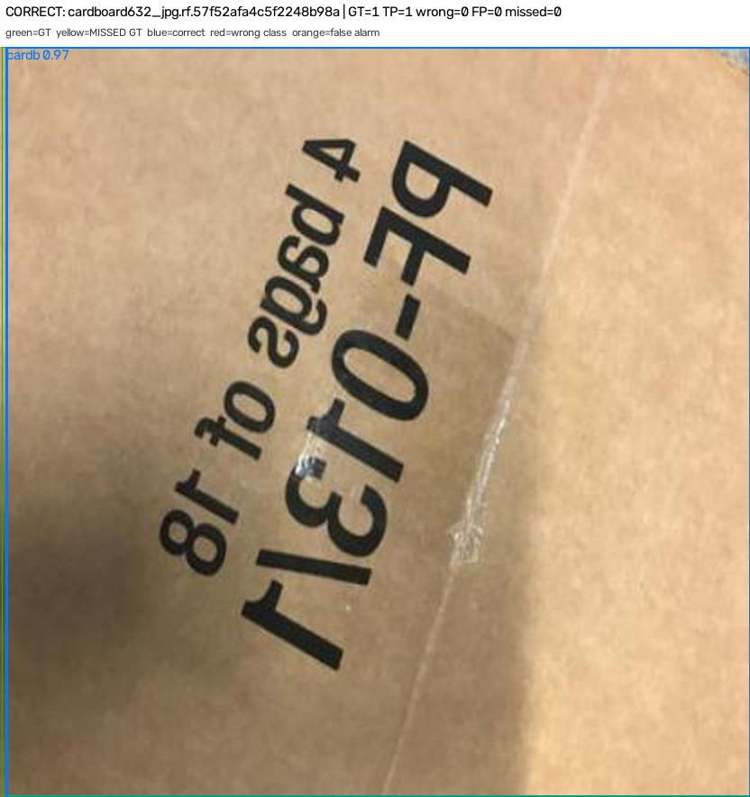
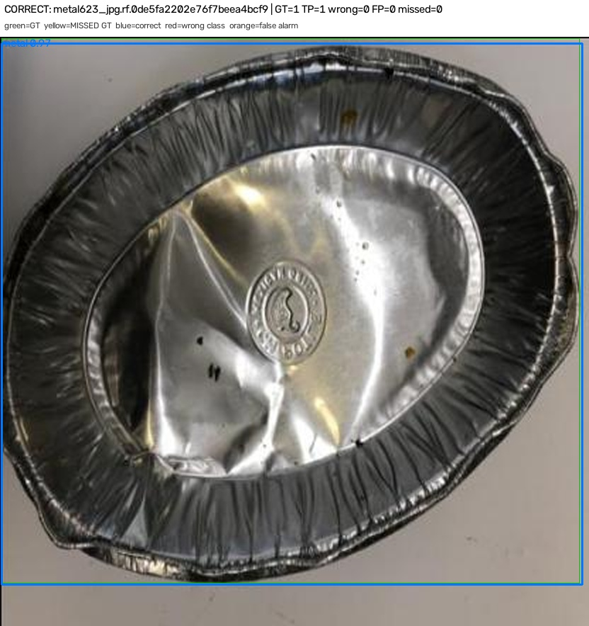
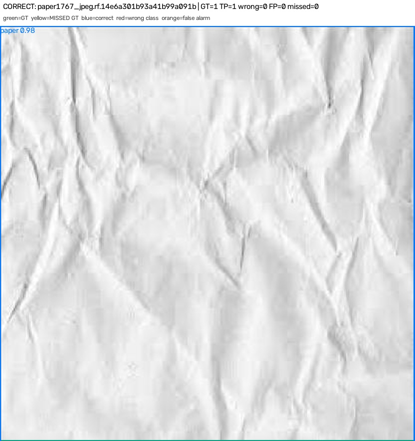
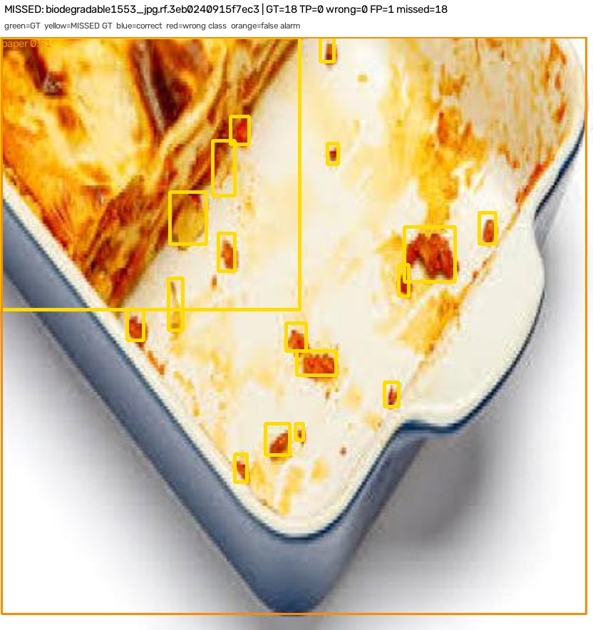
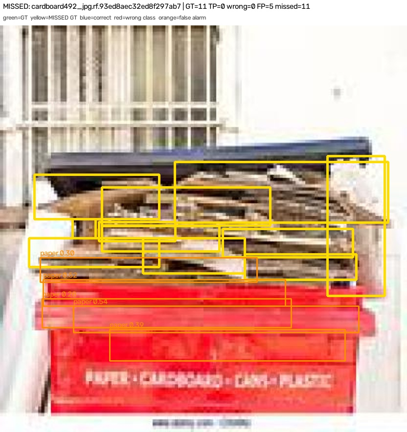
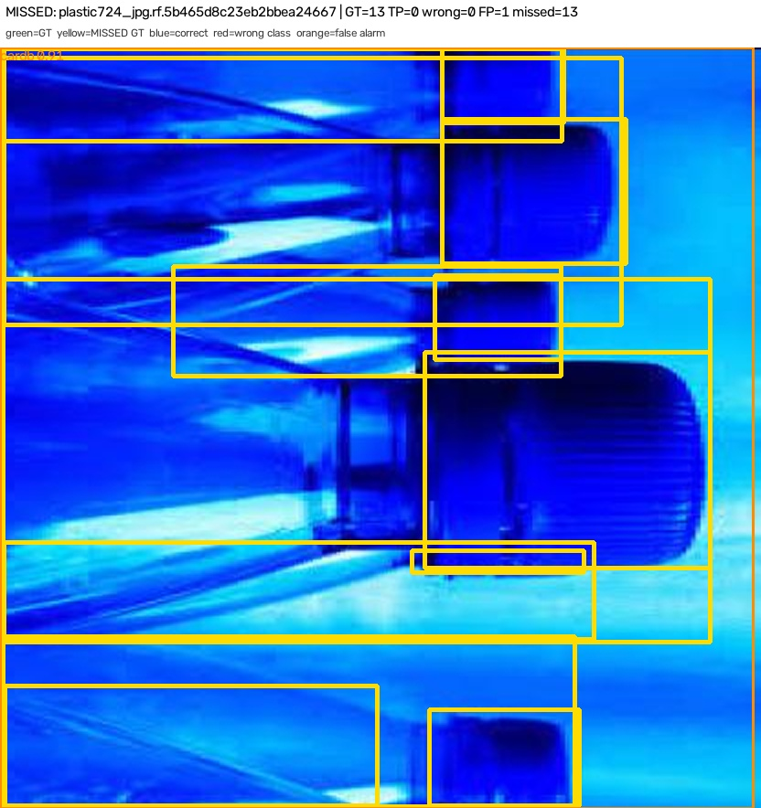
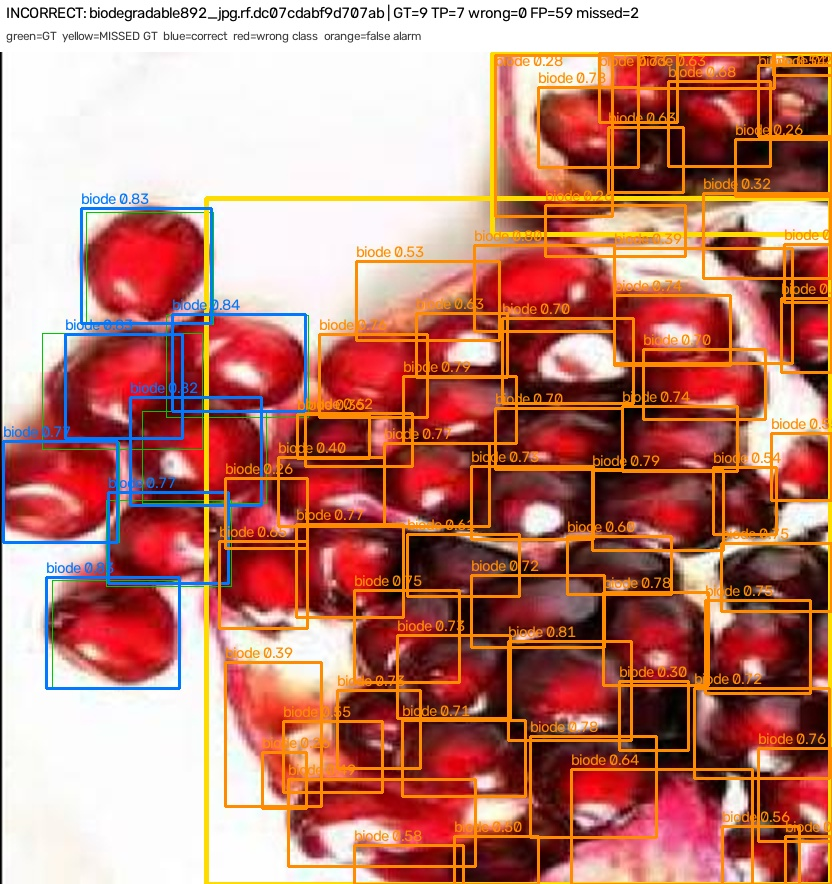
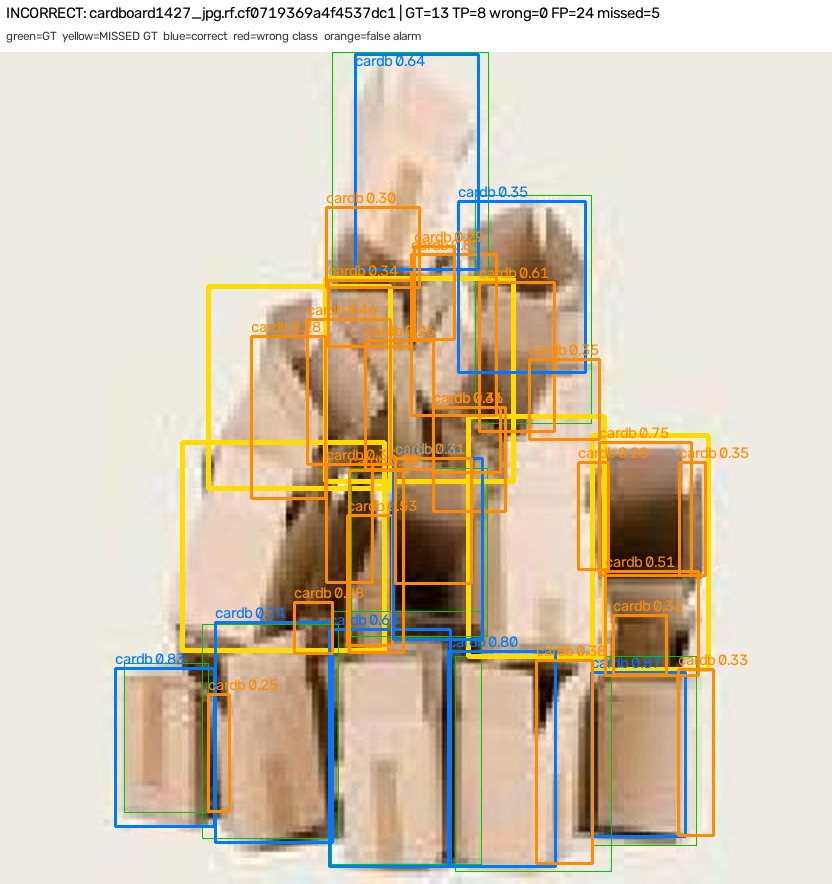
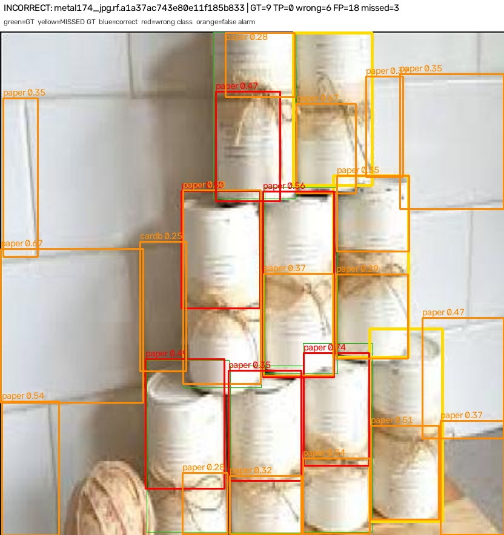

# Task 3: Visualization and Error Analysis

## Setup

The final model (YOLO26s, selected on validation mAP50–95; best checkpoint
`yolo26s_baseline-2`) was run on all 1,569 test images (11,098 annotated
objects) with confidence 0.25, NMS IoU 0.6 and at most 400 detections per
image. Predictions are matched to ground truth with IoU >= 0.5 (greedy, by
confidence). Each prediction is then one of:

- **correct**: matches a ground-truth box with the right class;
- **wrong class**: matches a ground-truth box but with a different class;
- **false alarm**: matches no ground-truth box.

A ground-truth object with no matching prediction is **missed**.

Colour code in the figures: green = ground truth, blue = correct,
red = wrong class, orange = false alarm, yellow = missed ground truth.

Reproduce (from the repository root, with the model at
`assignment-1/models/yolo26s_best.pt`):

```powershell
python assignment-1\make_team_test.py --list assignment-1\data\split\test.txt --src assignment-1\GarbageDataset --dst assignment-1\data\team_test
python assignment-1\error_analysis.py --weights assignment-1\models\yolo26s_best.pt --images assignment-1\data\team_test\images --labels assignment-1\data\team_test\labels --device cpu
```

Outputs: `results/predictions/{correct,missed,incorrect}/` and
`results/metrics/{errors_per_class,class_confusions,error_summary_per_image}.csv`.

## Overall result

| Outcome | Objects |
|---|---:|
| Correct | 5,889 |
| Wrong class | 213 |
| Missed | 4,996 |
| False alarms (predictions) | 2,045 |

| Class | GT objects | Missed | Missed % | Wrong class | False alarms |
|---|---:|---:|---:|---:|---:|
| Biodegradable | 6,805 | 3,445 | 50.6% | 33 | 997 |
| Cardboard | 703 | 287 | 40.8% | 24 | 343 |
| Glass | 1,165 | 365 | 31.3% | 37 | 127 |
| Metal | 875 | 269 | 30.7% | 42 | 162 |
| Paper | 658 | 241 | 36.6% | 27 | 180 |
| Plastic | 892 | 389 | 43.6% | 50 | 236 |

Most frequent class confusions (true class -> predicted class): biodegradable
-> cardboard (18), cardboard -> paper (18), glass -> metal (17), plastic ->
glass (15), metal -> glass (15), plastic -> paper (15).

## Example detections

### Correct detections





Single, large, well-isolated objects (a flattened box, an aluminium tray,
crumpled paper) detected with confidence of about 0.97. This is the easy case:
one object that fills most of the image and has a distinctive texture or
material.

### Missed detections





All three are crowded or unusual scenes with 11-18 annotated objects.

- `biodegradable1553`: the model predicted one large box (labelled paper) over
  the tray and none of the 17 small food-scrap boxes.
- `cardboard492`: the annotated pieces overlap in a stack; the model produced
  only a few low-confidence boxes with the wrong class that did not reach
  IoU 0.5.
- `plastic724`: the image is strongly colour-shifted (blue) and the bottles
  overlap heavily; only one prediction (a false alarm) was made.

### Incorrect detections





- `biodegradable892`: 9 annotated objects, but 59 false alarms, mostly on
  further pomegranate seeds that are not annotated.
- `cardboard1427`: 24 false alarms on a pile of boxes.
- `metal174`: 6 of 9 cans were labelled paper (red); the cans are white with
  paper labels.

## Analysis of the errors

1. **Missed objects are the dominant error, not class confusion.** 4,996
   objects were missed (45% of all) while only 213 were detected with the
   wrong class (1.9%). Once an object is found, its class is mostly right.
2. **Crowded scenes are much harder.** In the 117 test images with more than
   20 objects, 58.6% of the objects were missed (3,880 of 6,616); in the 1,452
   images with at most 20 objects, 24.9% were missed (1,116 of 4,482). Overlap
   and occlusion make boxes hard to separate, and IoU 0.5 is strict for small
   boxes: 36.45% of all boxes cover less than 1% of the image, and the source
   images are only 416 x 416 pixels, so upscaling to 640 adds no detail.
3. **Biodegradable is the weakest class despite having the most boxes** (test
   AP50-95 31.4%, 50.6% missed, 997 false alarms). It is therefore not a simple
   class-imbalance problem. The class contains many small, irregular and
   visually diverse objects (food scraps, seeds) with unclear boundaries, so
   even correct predictions can fail the IoU criterion. In the examples the
   model also finds more instances than are annotated, which suggests
   inconsistent annotation granularity (a hypothesis that needs a manual check;
   it was not verified).
4. **Cardboard has many false alarms relative to its size** (343 false alarms
   for 703 objects), mainly on piles of boxes where individual instances are
   ambiguous.
5. **Class confusions occur between visually similar materials**, e.g.
   biodegradable/cardboard, cardboard/paper, glass/metal, plastic/glass:
   materials that share colour, texture, transparency or reflection, or objects
   whose appearance is dominated by a different material (a can with a paper
   label).

## Limitations of the final model

- Limited recall (about 55%): nearly half of the objects in crowded scenes are
  not found, which would matter in a real sorting system.
- Weak on small, overlapping and unusually coloured objects.
- Results depend on annotation quality: only a sample of 30 images was visually
  reviewed, and incomplete or inconsistent labels appear as false alarms and
  misses.
-Possible duplicate leakage: the team's wider duplicate search (Assignment 2, Task 1, section 4.4) found 44 of its 307 duplicate groups still crossing the train/validation/test split; about 19 of them were judged real copies of a test image (about 1.2% of the 1,569 test images). The test scores may therefore be slightly optimistic. Duplicates found by neither search can also remain, and duplicates kept inside the same subset can give some sources extra weight.
- One model on one split; no confidence intervals were computed.
- The figures show 9 selected examples, not a random sample.

## Possible improvements

- **Annotation review:** check crowded and biodegradable images for missing or
  loose boxes and correct genuine errors only (do not remove hard examples).
- **Small and crowded objects:** test higher input resolution or tiled
  (sliced) inference, a larger model, and moderate mosaic augmentation
  (planned as `--mosaic 0.3`); evaluate each on the validation set first.
- **Post-processing:** tune the NMS IoU threshold and the confidence threshold
  for dense scenes, possibly per class.
- **Training:** a short AdamW refinement did not beat the SGD baseline (43.7%
  vs 44.2% validation mAP50-95), so longer training alone is not a
  demonstrated fix.
- **Evaluation:** report AP separately for small and crowded objects to confirm
  the causes above.
