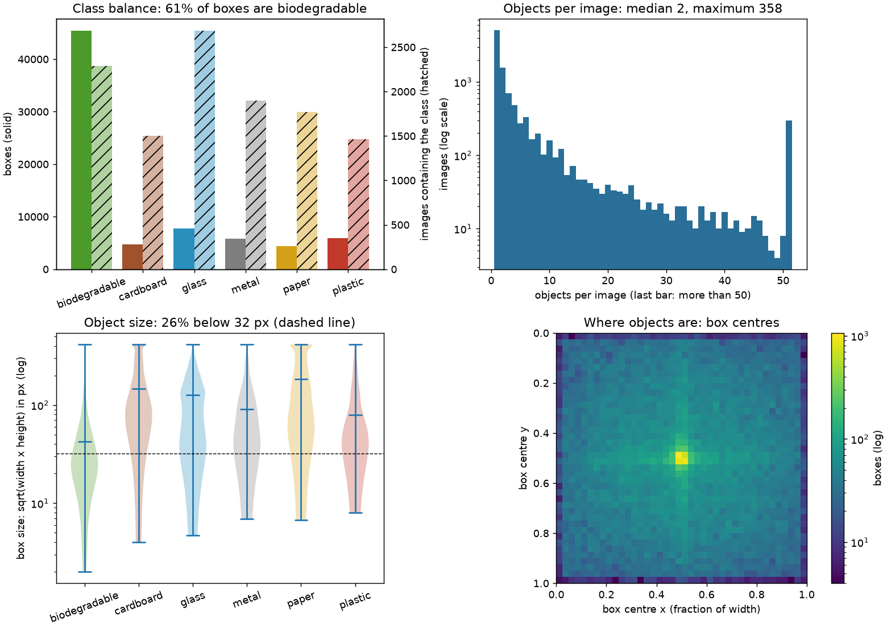
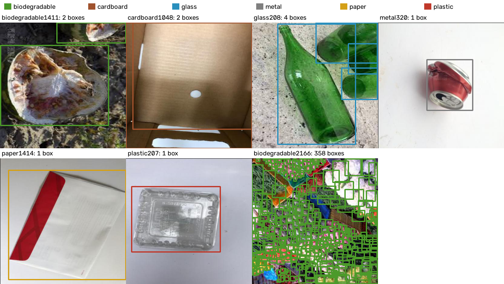
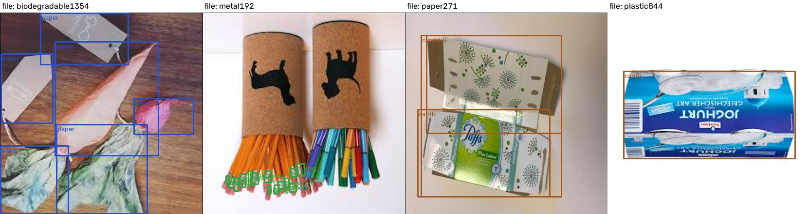
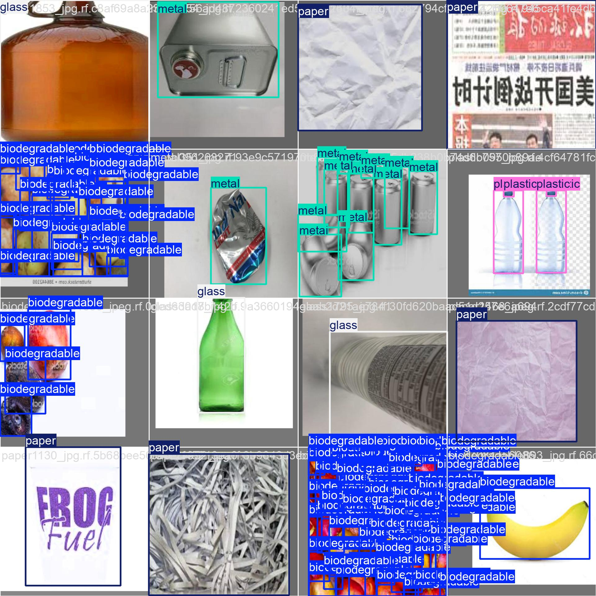

# Task 1: Dataset analysis and training pipeline

## From data findings to design decisions

| Finding (measured) | Consequence for the pipeline | Where |
| --- | --- | --- |
| Biodegradable has 61.3% of the 74,073 boxes; 10.3 times more boxes than the smallest class in training | Split balanced per class (image presence and box counts); per-class AP always reported; no oversampling until validation shows a need | [Split](#reproducible-trainvalidationtest-split), [Task 2](../task-2/README.md) |
| 1 to 358 objects per image; 5,082 images hold one object, while the 5% most crowded images hold about half of all boxes | Detection cap `max_det=400` (checked: raising it to 500 changes test mAP50–95 by 0.03 points); results reported by crowding | [Parameters](#training-parameters-and-strategy), [Task 3](../task-3/README.md) |
| 36.45% of boxes cover under 1% of the image | 640-pixel input instead of the native 416. The baseline used mild scaling (0.2) and no mosaic; a later check showed mosaic does not shrink objects, so the final model uses mosaic and stronger augmentation (test mAP50–95 44.5% → 51.8%) | [Preprocessing](#selected-detector-and-preprocessing), [augmentation](#training-only-augmentation) |
| Initial review found 267 duplicate groups; later audits found 44 more groups crossing the split, and an 8-orientation search 6 more test images (29 affected test images in total) | Keep reviewed groups together, disclose remaining leakage, and evaluate again after excluding the affected test images (final model: mAP50–95 51.8% full, 51.9% after excluding all 29; baseline 44.5% and 44.7% after excluding 23) | [Duplicates](#duplicate-review-and-leakage-prevention) |
| 17 zero-area boxes | Removed, logged and verified; every other box kept | [Cleaning](#annotation-cleaning) |
| All images are 416 x 416 and decode correctly; no exact duplicates | Same letterbox preprocessing for every split; no image dropped | [Audit](#audit-results) |
| File-name class differs from the labels in 133 images | Labels, not file names, are the ground truth; class names confirmed by the export's `data.yaml` | [File names](#file-names-versus-labels) |
| 220 to 398 test images per class | Test used once, after all choices were made on validation; 95% confidence intervals reported | [Evaluation design](#model-selection-and-evaluation-design) |
| Training hardware: one 8 GB RTX 5050 laptop GPU (baseline); Apple M4 Pro GPU (final model) | Small model (YOLO26s), mixed precision; batch 4 for the baseline, batch 16 for the final model | [Parameters](#training-parameters-and-strategy) |


## Task 1 files

| Work | Evidence and implementation |
| --- | --- |
| Dataset audit and annotation review | [Audit results](../reports/audit.json), [audit script](../audit_dataset.py), [annotation sampling script](../sample_annotations.py) |
| Duplicate detection and review | [Duplicate detection pipeline](../duplicates/README.md), [supplied duplicate lists](../data/team-duplicates/), [review decisions](../reports/duplicate-review/review.csv) |
| Label cleaning | [Verification notes and removal log](../data/prepared/README.md) |
| Train, validation, and test split | [Split documentation](../data/split-README.md), [manifest](../data/split/manifest.csv), [split summary](../data/split/summary.json), [split script](../prepare_split.py) |
| Dataset export | [YOLO export script](../export_yolo.py) |

Training and evaluation use the fixed split and exported data in the shared
`assignment-1/data/` directory. The original dataset is local in
`assignment-1/GarbageDataset/`.


Status update (2026-11-12): the 60-epoch baseline has completed. The
[training review](../task-2/training-review.md) records verified validation results,
Task 1 requirement checks and proposed improvement experiments. Training-status
notes below are the historical pipeline and diagnostic record.

## Audit results

- 10,464 images, all 416 x 416 pixels. All opened successfully.
- 10,464 matching label files, with no missing, empty, or orphan labels.
- 74,073 valid bounding boxes across six class IDs.
- 17 additional rows with zero-width or zero-height boxes.
- No exact image duplicates, checked by file contents and decoded pixels.
- 26,997 boxes (36.45%) cover less than 1% of an image. This is a relative-area
  threshold, not the COCO definition of a small object.
- Between 1 and 358 valid objects per image; 5,082 images contain one object.

## Class distribution

| ID | Class name | Valid boxes | Images containing class |
| --- | --- | ---: | ---: |
| 0 | biodegradable | 45,395 | 2,287 |
| 1 | cardboard | 4,696 | 1,502 |
| 2 | glass | 7,809 | 2,684 |
| 3 | metal | 5,841 | 1,898 |
| 4 | paper | 4,387 | 1,768 |
| 5 | plastic | 5,945 | 1,464 |

Class names were first inferred from filename patterns and are confirmed by
the `data.yaml` of the same Roboflow export ("garbage-classification-3", version 2, CC BY 4.0), which lists BIODEGRADABLE, CARDBOARD, GLASS, METAL, PAPER, PLASTIC for ids 0 to 5. That copy
(downloaded from Kaggle) has the same 10,464 file names. Images can contain multiple
classes, so image counts overlap. The filename alone does not determine the
class of every object in an image.

### Dataset figures



- **Class balance:** biodegradable has 61% of the boxes but appears in fewer
  images than glass; the imbalance is in boxes per image more than in images.
- **Objects per image:** most images hold one or two objects, with a long tail
  up to 358 (the last bar collects all images with more than 50).
- **Object size:** 26% of boxes are smaller than 32 x 32 pixels (COCO "small");
  biodegradable objects are the smallest, paper and cardboard the largest.
- **Box centres:** objects cluster in the image centre, with fewer near the
  borders; translation and scaling augmentation (0.1, 0.2) vary this.



Generated by [dataset_figures.py](dataset_figures.py) from the cleaned labels.

## Visual review

We reviewed the initial preview and all 30 random sample images (five per class,
seed 42). The boxes appeared to fit the visible objects. The random sample
contained 30 unique images. No placement corrections were identified.

The images include crowded scenes, overlapping objects, small objects, and some
watermarks. The review covers box placement in these examples; it does not
confirm every class label or establish that all objects have been annotated.
Invalid rows were not drawn in the previews.

## File names versus labels

Every file name starts with a class word (`glass349_jpg...`). In 133 of the
10,464 images (1.3%) the most frequent label class differs from that word;
39 of them contain no box of the file-name class at all. They are spread over
the splits (train 91, validation 22, test 20) and listed in
[name-label-mismatches.csv](../reports/name-label-mismatches.csv)
([check_name_label_mismatch.py](../check_name_label_mismatch.py)).
The most common pairs are paper filed, cardboard labelled (21), glass filed
with mainly biodegradable (20), metal (18) or plastic (18) boxes, and
cardboard filed, paper labelled (12).



Four test images from the 39, with their annotated boxes:

- **biodegradable1354:** paper tags and crumpled paper, labelled paper. The
  labels fit the picture; the file name does not.
- **metal192:** two cork-covered pencil holders. The holders are not labelled;
  instead 14 tiny biodegradable boxes sit on pencil tips. This is a genuine
  annotation problem.
- **paper271:** a flattened tissue box labelled cardboard: the fuzzy boundary
  between paper and cardboard.
- **plastic844:** a cardboard sleeve of a yoghurt multipack labelled
  cardboard; the plastic cups inside are not labelled.

So the file-name class is not a reliable ground truth, and the labels, not
the names, are used everywhere in this project. Most mismatches are plausible
labels on mixed or borderline images; a few, such as metal192, are real
annotation errors. They were kept unchanged, because a full relabelling
review was out of scope, and they are one reason for the paper/cardboard and
glass/metal/plastic confusions reported in Task 3.

## Duplicate review and leakage prevention

The SIFT/RootSIFT loose search produced 364 unique candidate pairs with at least
15 RANSAC inliers. Every pair was manually reviewed. A pair was marked
`same_source` when it showed the same source picture, including rotation,
mirroring, cropping or color edits. Separate photographs were marked
`different_images`, even if they depicted similar objects.

Final decisions in [review.csv](../reports/duplicate-review/review.csv): **341 same-source
pairs, 23 different-image pairs, zero pending or uncertain decisions**. These
are pair counts, not counts of removable images. The 23 different pairs are:
56, 91, 173, 189, 197, 208, 220, 221, 228, 233, 235, 255, 256, 267, 273, 282,
309, 326, 328, 350, 351, 353 and 361.

Confirmed links were merged transitively into connected groups. If A matches B
and B matches C, all three stay together. There are 267 non-singleton groups;
the largest contains five images. Including singleton images gives 10,156
independent allocation groups. The original review-defined groups stay within
one subset. The follow-up audit below found 44 additional groups crossing
subsets, so the full split still contains known source leakage.
Historical teammate lists supplied reference labels only; current review
verdicts determined grouping. Unflagged images are not proven unique.

**Follow-up audit found 44 groups crossing the split.** A wider, independent duplicate search
(307 groups, 664 images; [team-duplicates](../data/team-duplicates/README.md))
was used only as reference labels, not for grouping. Merged with the confirmed
pairs, 44 of its groups cross the split: 23 test images have a copy in
training or validation and 26 validation images a copy in training (test+train 19 groups,
train+val 21, test+val 2, all three 2). One of the 23 test images, `metal708`,
appears in review pairs 56 and 235 (with `metal764` and `metal846`), which the
review marked `different_images` but a second visual check judged to be the
same source. The effect on the final score was measured in
[Task 2](../task-2/README.md#test-score-without-leaked-duplicates-baseline): removing the
23 test images changes test mAP50–95 from 44.5% to 44.7% for the baseline and
from 51.8% to 51.9% for the final model.

Duplicates were retained together in one subset rather than deleted. This
prevents leakage between the confirmed copies while preserving images and labels.
Related images within a subset can still give repeated sources extra weight;
this remains a limitation of the retained dataset.

## Annotation cleaning

The original dataset remains unchanged. The prepared label copies were checked
against all original labels. Exactly 17 zero-area rows were removed, matching
[the removal log](../data/prepared/removed_rows.txt). Every valid annotation was
preserved in order, with no other annotation changes. The cleaned dataset
contains all 10,464 images and 74,073 valid boxes. Numeric validation does not
establish visual annotation completeness or correctness.

## Reproducible train/validation/test split

The target is 70/15/15 with seed 42. `prepare_split.py` allocates entire duplicate
groups, balancing image counts, per-class image presence and per-class box
counts. It uses all class IDs in an image rather than only its dominant class.
The allocation is greedy, not a guarantee of globally optimal stratification.
Rounded image-count capacities constrain the subset sizes.

| Subset | Images | Actual share | Purpose |
| --- | ---: | ---: | --- |
| Training | 7,325 | 70.002% | Learn model parameters; training augmentation only |
| Validation | 1,570 | 15.004% | Select checkpoint and tune settings |
| Test | 1,569 | 14.994% | Final evaluation after settings are fixed |

### Valid bounding boxes by class and subset

| ID | Working class name | Train | Validation | Test | Total |
| --- | --- | ---: | ---: | ---: | ---: |
| 0 | biodegradable | 31,772 | 6,818 | 6,805 | 45,395 |
| 1 | cardboard | 3,289 | 704 | 703 | 4,696 |
| 2 | glass | 5,476 | 1,168 | 1,165 | 7,809 |
| 3 | metal | 4,091 | 875 | 875 | 5,841 |
| 4 | paper | 3,072 | 657 | 658 | 4,387 |
| 5 | plastic | 4,161 | 892 | 892 | 5,945 |

### Images containing each class

These counts overlap because an image can contain multiple classes.

| ID | Working class name | Train | Validation | Test |
| --- | --- | ---: | ---: | ---: |
| 0 | biodegradable | 1,601 | 343 | 343 |
| 1 | cardboard | 1,051 | 226 | 225 |
| 2 | glass | 1,885 | 401 | 398 |
| 3 | metal | 1,328 | 285 | 285 |
| 4 | paper | 1,237 | 266 | 265 |
| 5 | plastic | 1,024 | 220 | 220 |

All six classes occur in every subset. Every image is assigned once; manifest
coverage, list consistency and confirmed duplicate isolation were checked.
The repeated split run produced the same reported counts and input fingerprints.
The fixed [manifest](../data/split/manifest.csv),
[summary](../data/split/summary.json) and filename lists record the result.
The split used NumPy 2.5.4; its version and input SHA-256 fingerprints are in
the summary. The test subset is kept fixed and is not used to select settings.

## YOLO dataset export

`export_yolo.py` uses the fixed manifest without generating new assignments.
It copies source images and verified cleaned labels into parallel directories:

```text
data/processed/
  images/train/    labels/train/
  images/val/      labels/val/
  images/test/     labels/test/
  data.yaml
  manifest.csv
  split-summary.json
  export-report.json
```

All 10,464 image/label pairs were exported. SHA-256 verification confirmed that
every copied image matches its source and every label matches its cleaned copy.
An independent check confirmed exact expected filenames in each subset and an
unchanged manifest. Existing output directories are refused to prevent stale
files from introducing cross-subset leakage. Dataset copies remain local and
are excluded from Git; code, review decisions and split manifests are versioned.

## Selected detector and preprocessing

The selected baseline is **COCO-pretrained YOLO26s (`yolo26s.pt`)**, fine-tuned
using the Ultralytics Python API. It is a practical small-model starting point
for the available Intel i7 / NVIDIA RTX 5050 system with 8 GB GPU memory.
Its test results are in [Task 2](../task-2/README.md): mAP50–95 44.5% with the
baseline recipe and 51.8% with the final, stronger recipe.

The initial input size is 640 pixels. The loader applies aspect-ratio-preserving
resize/letterbox and scales RGB intensities to [0, 1]; no separate dataset
mean/std normalization is added. Sources are 416 x 416, so upscaling adds no
new source detail. The rationale is to test whether a larger model input grid
helps localization of small objects; any benefit must be established using
validation. A 416-pixel comparison may be made if compute permits.

## Training-only augmentation

| Transformation | Baseline setting | Final model | Rationale |
| --- | --- | --- | --- |
| Horizontal flip | Probability 0.5 | 0.5 | Vary object orientation |
| Translation | 0.1 | 0.1 | Reduce reliance on fixed object position |
| Scaling | 0.2 | 0.5 | Size variation; the check below shows how much it shrinks objects |
| HSV hue/saturation/value | 0.015 / 0.3 / 0.2 | 0.015 / 0.7 / 0.4 | Color and illumination variation |
| Rotation, vertical flip | Disabled | 10 degrees, probability 0.5 | Waste lies in any orientation on a belt or pile |
| Shear, perspective | Disabled | Disabled | Not needed for top-down photos |
| Mosaic | Disabled | 1.0, off for the last 10 epochs | More objects and contexts per sample; does not shrink objects (check below) |
| Mixup, copy-paste | Disabled | Disabled | Would blend materials, which the labels do not describe |

The baseline settings were first design choices. The final settings were
compared with them in one training run on the same split and selected on
validation (mAP50–95 44.2% → 51.2%); see
[Task 2](../task-2/README.md#final-model-stronger-training-recipe). Several
settings changed together (augmentation and batch size), so the gain belongs
to the recipe as a whole, not to one setting. Validation and test use
deterministic preprocessing without random training augmentation.

**Checked after training: what the augmentation does to object sizes.** The
original concern was that strong augmentation would shrink the many small
objects further. [augmentation_check.py](augmentation_check.py) passes 1,000
random training images through the Ultralytics training loader and measures
every box in pixels of the 640-pixel network input (no training involved):

| Setting | Boxes measured | Median box size | Boxes under 16 px | Boxes under 32 px |
| --- | ---: | ---: | ---: | ---: |
| No augmentation | 7,656 | 84.6 px | 0.7% | 12.5% |
| Baseline (scale 0.2, translate 0.1, flips, HSV) | 7,368 | 84.7 px | 1.5% | 14.5% |
| Baseline + mosaic 1.0 | 10,535 | 92.2 px | 0.9% | 12.1% |

- The baseline makes slightly more boxes small (14.5% under 32 px against
  12.5%), through the random down-scaling of up to 20%.
- **Mosaic does not shrink objects** in this implementation: each of the four
  photos keeps its full 640-pixel scale on a 1,280-pixel canvas, and a
  640-pixel window is cropped from it. It shows parts of several photos (more
  boxes per sample) rather than smaller objects. The concern that led us to
  turn mosaic off is therefore not supported. The training run with mosaic and
  stronger augmentation then improved validation mAP50–95 from 44.2% to 51.2%
  ([Task 2](../task-2/README.md#final-model-stronger-training-recipe)).



The augmented samples above (16 random training images, baseline settings)
show flips, shifts (grey borders), mild scaling and colour changes, with every
box still on its object.

## Training parameters and strategy

The implementation is [train_detector.py](../train_detector.py).

| Setting | Initial value | Reason |
| --- | --- | --- |
| Initialization | COCO-pretrained YOLO26s; fine-tune all layers | Transfer learned visual features |
| Maximum epochs | 60 | Upper training budget, not a required duration (baseline: best epoch 57; final model: best epoch 50) |
| Early stopping | Patience 20 | Stop after sustained lack of validation fitness improvement |
| Batch size | 4 (baseline), 16 (final model) | 4 was a conservative start for 8 GB VRAM; the final model was trained with 16 on a larger GPU |
| GPU / mixed precision | Device 0 / AMP enabled | Use available GPU while limiting memory demand |
| Data workers | 2 | Conservative Windows loading configuration |
| Seed / deterministic option | 42 / enabled | Improve repeatability; not a cross-platform identity guarantee |
| Optimizer | SGD | Explicit, documented baseline optimizer |
| Initial learning rate | 0.01 | Starting value, subject to validation-based adjustment |
| Momentum / weight decay | 0.937 / 0.0005 | Momentum optimization and regularization |
| Warmup | 3 epochs | Gradually introduce the training learning rate |
| LR schedule | Cosine; final factor 0.01 | Decrease the learning rate over training |
| Detection cap | 400 | Allow evaluation of scenes with up to 358 labeled objects |
| Training fraction | 1.0 | Use the full fixed training subset for the baseline |

The detection cap applies to prediction/validation output, not the number of
training annotations loaded. Keep `max_det=400` for final evaluation as well.
Small batches may use gradient accumulation internally; record the resolved
arguments and optimizer behavior from the installed implementation. This is a
custom fine-tuning baseline, not a reproduction of the published YOLO26 recipe.

Class 0 contributes 61.28% of valid objects. No oversampling or custom class
weighting is applied initially: first measure per-class validation performance.
Consider balancing only if those results justify a controlled follow-up.

## Model selection and evaluation design

Use the saved best checkpoint according to the installed Ultralytics validation
fitness. The exact fitness definition must be recorded with the package version;
no YOLOv5-specific weighted formula is assumed for YOLO26. Training uses the
validation subset for checkpoint selection and early stopping. Hyperparameters,
resolution and any operating confidence threshold are selected using validation.

After those choices are fixed, evaluate the best checkpoint on the untouched
test subset. Report mAP50-95, mAP50, per-class AP, precision and recall. Per-class
results are needed because aggregate scores can obscure minority-class failures.
Review small objects, overlaps and crowded scenes. Subsequent assignment tasks
will include examples of correct, missed and incorrect detections and analysis
of plausible failure causes. The test results are reported in
[Task 2](../task-2/README.md) and analysed in [Task 3](../task-3/README.md).

## Reproduction and implementation evidence

From `assignment-1`, with the environment activated:

```powershell
python audit_dataset.py
python check_duplicates.py
python preview_duplicates.py
# Review pair decisions before generating the split.
python prepare_split.py
python export_yolo.py
python train_detector.py --dry-run
```

The audit command replaces its audit report. Preview generation creates a fresh
review on reruns; it is unnecessary for the completed reviewed set. Split and
export commands refuse existing outputs. Use a fresh `--output` destination
when reproducing, and explicitly pass that manifest directory to the exporter
if using an alternate split. Preserve the current completed review.

Completed verification: all seven audit/split/export unit tests passed;
full-data cleaning, split integrity and copy checks passed; the YOLO26s
configuration dry run passed. A dry run does not execute the training API or
verify GPU kernels. The local environment now uses PyTorch 2.11.0+cu128, torchvision 0.26.0+cu128
and Ultralytics 8.4.208, pinned in `requirements-training.txt`. CUDA matrix
multiplication and torchvision CUDA NMS passed on the RTX 5050 Laptop GPU.
An initial full-training attempt failed with a CUDA illegal instruction after
21 batches. Synthetic forward/backward checks subsequently passed with and
without AMP; the original failure was not reproduced. A one-epoch real-data
smoke run on 2% of the training subset completed with AMP disabled, workers 0
and synchronous CUDA reporting, including validation. This is a tested
workaround, not proof that AMP caused the crash.

The user subsequently reported completion of the first full-data epoch:
2.54 GB reported GPU memory, 6 min 18 sec training plus 30.1 sec validation;
validation precision 0.419, recall 0.360, mAP50 0.319 and mAP50-95 0.199.
These are preliminary Task 2 validation observations, not final test results.
The selected baseline remains documented above; the current diagnostic run
overrides AMP to disabled and workers to 0. Record those overrides with the
experiment. Full-training completion and final evaluation remain outstanding.

Run tests from the repository root:

```powershell
python -m unittest discover -s assignment-1/tests -v
```

## Scope and limitations

This document records Task 1's dataset analysis and designed training pipeline.
Full training and quantitative model evaluation belong to Task 2. The sampled
annotation review does not certify the entire dataset. Near-duplicate detection
may miss related sources, and retained repeated sources may affect weighting.
Class names are confirmed by the export's `data.yaml` (see Class distribution);
the original course download URL is recorded in the assignment PDF. The assignment asks
for an approach covered in lectures; lecture coverage has not been independently
verified here. No accuracy, speed or memory claim is made for an unrun model.
Individual group contribution statements should identify the actual members
responsible for these activities; names have not been supplied in this record.

## References and supporting files

- [Raw dataset audit](../reports/audit.json)
- [Duplicate review instructions](../reports/duplicate-review/README.txt) and [decisions](../reports/duplicate-review/review.csv)
- [Cleaned label verification notes](../data/prepared/README.md)
- [Split/export documentation](../data/split-README.md)
- [Official YOLO26 model documentation](https://docs.ultralytics.com/models/yolo26)
- [Official training argument documentation](https://docs.ultralytics.com/modes/train)
