# Task 3: Visualization and Error Analysis

## Setup

The final model (YOLO26s with the stronger training recipe, selected on
validation mAP50–95; best checkpoint `yolo26s_strongaug`, epoch 50, test
mAP50–95 51.8%, see [Task 2](../task-2/README.md#final-model-stronger-training-recipe)) was run on all 1,569 test images (11,098 annotated
objects) with confidence 0.25, NMS IoU 0.6 and at most 400 detections per
image. Predictions are matched to ground truth with IoU >= 0.5 (greedy, by
confidence). Each prediction is then one of:

- **correct**: matches a ground-truth box with the right class;
- **wrong class**: matches a ground-truth box but with a different class;
- **false alarm**: matches no ground-truth box.

A ground-truth object with no matching prediction is **missed**.

**Why confidence 0.25.** The threshold was chosen on the validation split,
not on test: [select_threshold.py](select_threshold.py) predicts the 1,570
validation images once and scores thresholds from 0.05 to 0.90 with the same
matching rule as below. F1 is highest at 0.25 (precision 77.8%, recall 60.3%,
F1 67.9%) and nearly flat around it (67.7% at 0.20, 67.2% at 0.30); the
baseline model also peaked at 0.25 (F1 62.3%); lower
thresholds add many false alarms, higher ones lose many objects
([full sweep](results/metrics/threshold_selection_val.csv)). The test split was
then analysed once at that threshold. The mAP values in Task 2 do not depend on
this threshold.

Colour code in the figures: green = ground truth, blue = correct,
red = wrong class, orange = false alarm, yellow = missed ground truth.

Run from the repository root after preparing the dataset. The script loads the
final YOLO26s checkpoint, [`assignment-1/models/yolo26s-strongaug-best.pt`](../models/README.md), by default
(pass `--weights assignment-1/models/yolo26s-best.pt` for the baseline).

```powershell
python assignment-1/task-3/error_analysis.py
```

The script uses the prepared test split and GPU 0 by default. Pass
`--device cpu` to use the CPU or `--help` to see the available overrides.

The checked-in examples and metrics are in `results/` beside this report.
The reproduction command writes to `runs/task3/` from the repository root.

## Overall result

| Outcome | Final model | Baseline |
|---|---:|---:|
| Correct | 6,585 | 5,889 |
| Wrong class | 154 | 213 |
| Missed | 4,359 | 4,996 |
| False alarms (predictions) | 1,616 | 2,045 |

| Class | GT objects | Missed | Missed % | Wrong class | False alarms |
|---|---:|---:|---:|---:|---:|
| Biodegradable | 6,805 | 2,978 | 43.8% | 13 | 997 |
| Cardboard | 703 | 284 | 40.4% | 9 | 99 |
| Glass | 1,165 | 332 | 28.5% | 44 | 117 |
| Metal | 875 | 222 | 25.4% | 19 | 164 |
| Paper | 658 | 240 | 36.5% | 22 | 85 |
| Plastic | 892 | 303 | 34.0% | 47 | 154 |

Most frequent class confusions (true class -> predicted class): glass -> metal
(25), plastic -> metal (22), glass -> plastic (14), plastic -> paper (13),
metal -> plastic (8), plastic -> glass (8). Compared with the baseline, the
final model misses 637 fewer objects and raises 429 fewer false alarms;
cardboard false alarms fell most (343 to 99).

## Example detections

### Correct detections

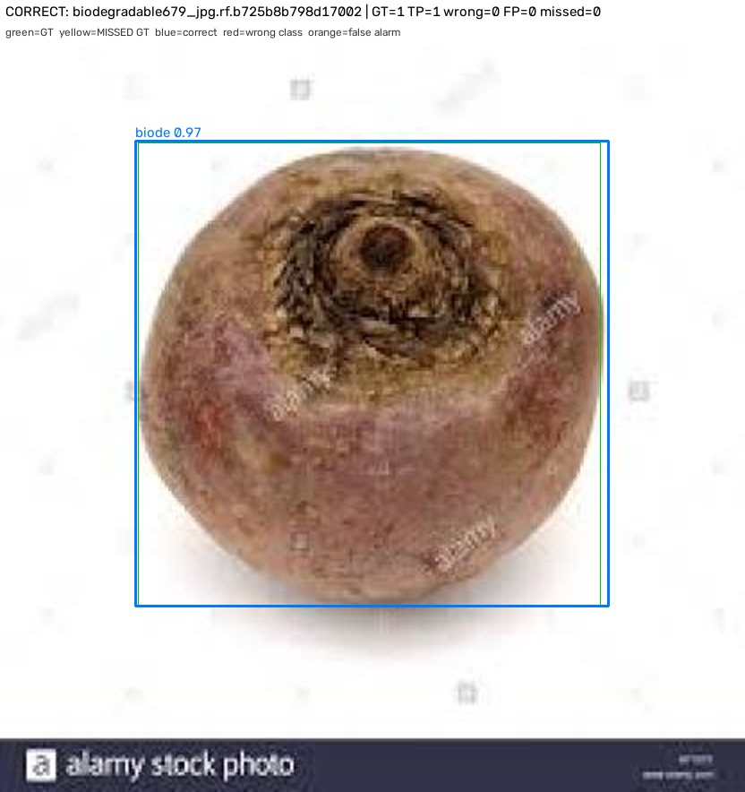
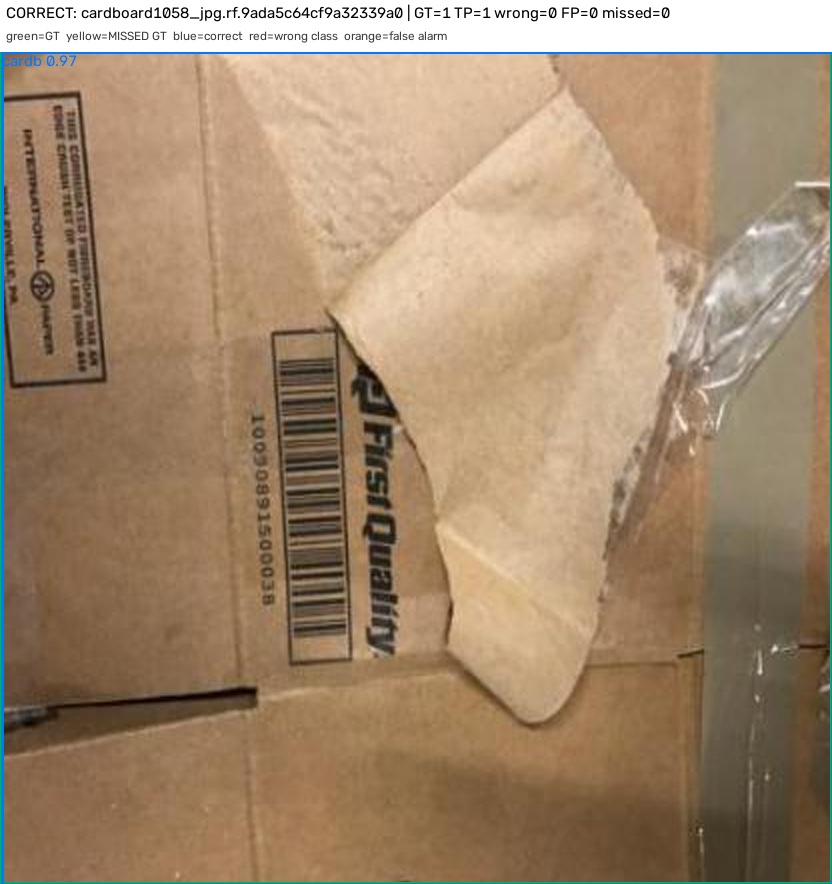
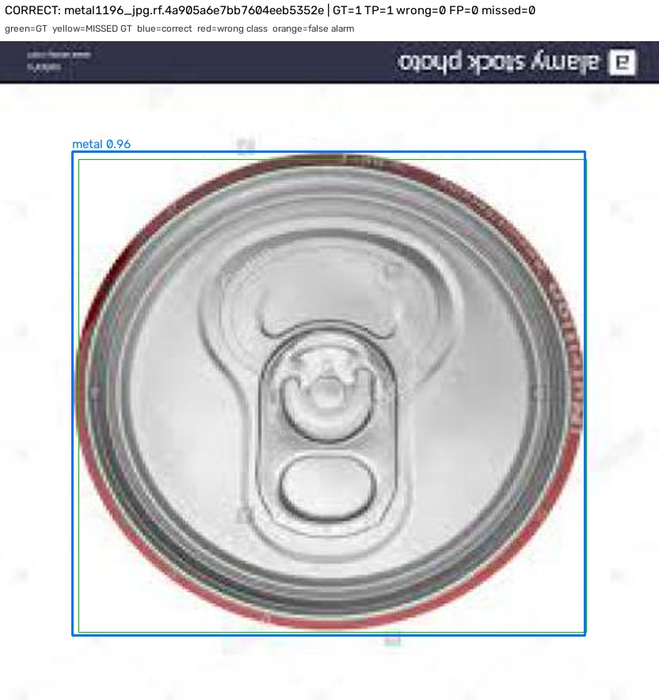

Single, large, well-isolated objects (a beetroot, a torn cardboard box, the
top of a can) detected with confidence 0.96–0.97. This is the easy case:
one object that fills most of the image and has a distinctive texture or
material.

### Missed detections

The model produced no prediction boxes in these three test images at confidence
0.25. Yellow boxes show the dataset objects that were missed.

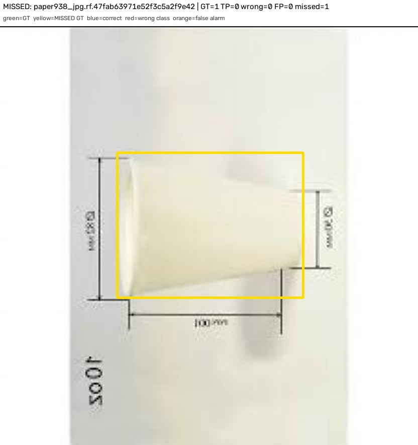

A paper cup drawn as a product sketch with dimension lines, rotated and pale on
a near-white background: unlike the photos the model was trained on.

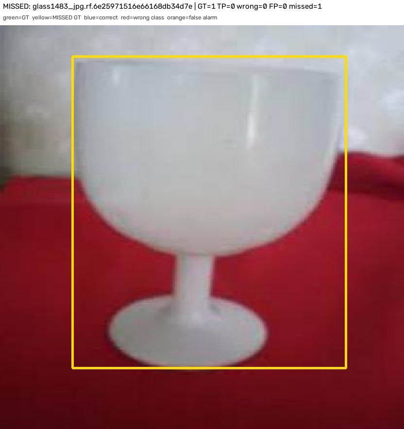

An opaque white goblet labelled glass. It lacks the transparency and
reflections that most glass objects in the dataset show.

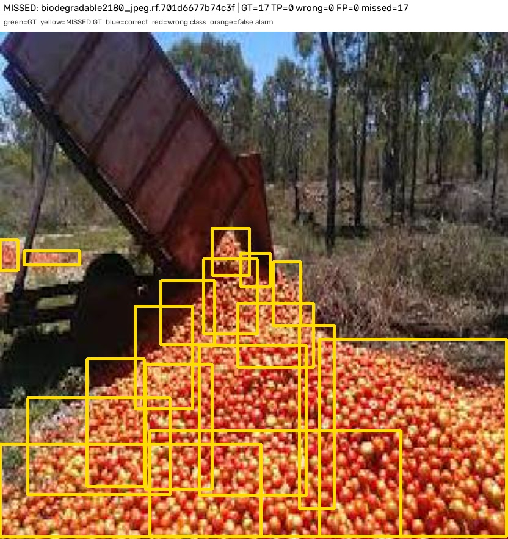

All 17 annotated regions of a tomato pile tipped from a trailer were missed.
The boxes cover arbitrary parts of one continuous pile, so there are no
separate objects to find: an annotation-granularity problem as much as a
model error.

### Incorrect detections

These examples show predictions with the wrong category. Red boxes mark
predictions that overlap a dataset box at IoU >= 0.5 but have a different class.

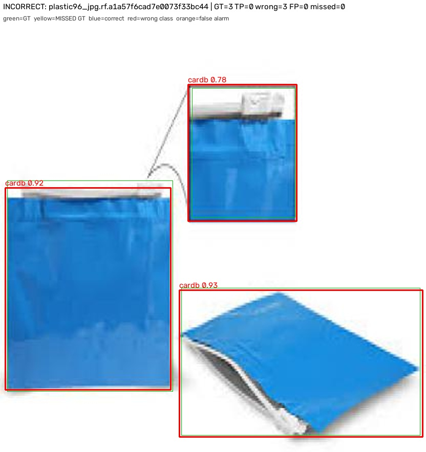

Three blue plastic mailing bags predicted as cardboard (confidence 0.78–0.93).
Flat, rectangular shipping packaging looks like cardboard; the boxes
themselves are well placed.

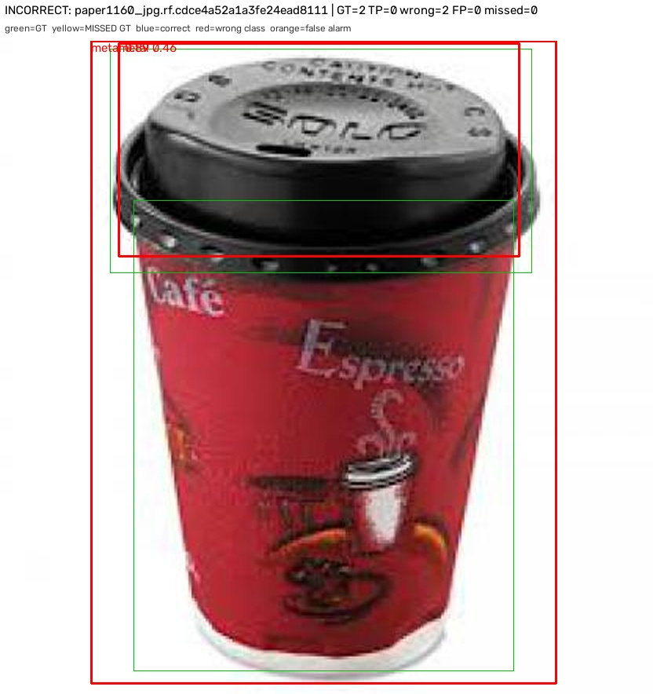

A takeaway cup whose lid and cup are both annotated as paper. The model calls
the lid metal (confidence about 0.89; the lid is actually plastic) and the whole
cup metal with low confidence (0.46): the dark, shiny lid dominates.

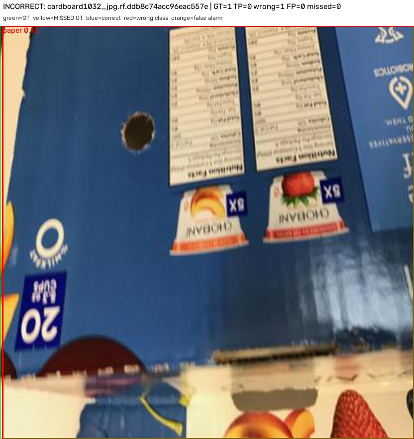

A close-up of a printed yoghurt carton annotated as cardboard and predicted as
paper (confidence about 0.81). At this distance the carton's printed surface
looks like a paper sheet; the cardboard/paper boundary is also fuzzy in the
labels.

## Where the model succeeds and fails

To test the explanations below with numbers, the test predictions (same
model, threshold 0.25 and matching rule) were split three ways
([breakdowns.py](breakdowns.py), [table](results/metrics/breakdowns_test.csv)).
Recall is the share of objects found with the right class; precision is the
share of predictions that are correct.

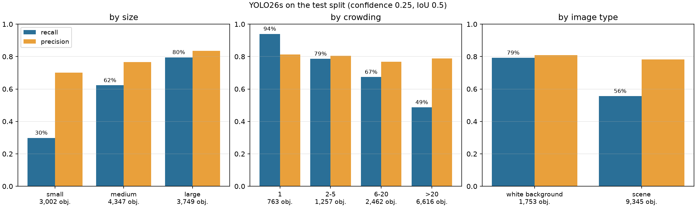

| Breakdown | Group | Images | Objects | Recall | Precision |
| --- | --- | ---: | ---: | ---: | ---: |
| Object size | small (< 32 x 32 px) | | 3,002 | 29.8% (baseline 26.0%) | 70.1% |
| | medium | | 4,347 | 62.3% (53.3%) | 76.6% |
| | large (>= 96 x 96 px) | | 3,749 | 79.5% (74.4%) | 83.6% |
| Objects per image | 1 | 763 | 763 | 94.0% (91.3%) | 81.2% |
| | 2–5 | 447 | 1,257 | 78.6% (73.8%) | 80.5% |
| | 6–20 | 242 | 2,462 | 67.4% (63.4%) | 76.8% |
| | more than 20 | 117 | 6,616 | 48.7% (40.8%) | 78.8% |
| Image type | white background (product photo) | 539 | 1,753 | 79.2% (71.2%) | 80.8% |
| | scene | 1,030 | 9,345 | 55.6% (49.6%) | 78.3% |

- **Size is the strongest factor.** Under a third of small objects are found
  (30%), against four fifths of large ones (80%). Precision falls less (70%
  vs 84%): small objects are mostly missed, not mistaken. The stronger recipe
  raised recall in every group, but small objects gained least (+3.8 points,
  against +9.0 for medium ones).
- **Crowding comes next.** A single object is found 94% of the time; in
  images with more than 20 objects, 49%. Those 117 images hold 60% of all test
  objects, which is why overall recall is only about 59%.
- **Image type matters less than it first appears.** Scenes look much harder
  (56% vs 79% recall), but they are also far more crowded. At the same
  crowding level the gap shrinks (single object: 94.5% vs 93.7%; more than 20
  objects: 57.4% vs 48.3%, but only 6 white-background images), except for
  6–20 objects (80.0% vs 62.7%), so clutter explains most of the gap and the
  background part of it
  ([table](results/metrics/recall_crowding_imagetype_test.csv), written by
  `breakdowns.py`).

**Recall by class and object size** ([class_size_recall.py](class_size_recall.py),
[table](results/metrics/recall_class_size_test.csv)):

| Class | Small: objects / recall | Medium: objects / recall | Large: objects / recall |
| --- | ---: | ---: | ---: |
| Biodegradable | 2,610 / 29.2% | 3,016 / 70.8% | 1,179 / 77.9% |
| Cardboard | 18 / 0.0% | 200 / 27.5% | 485 / 73.2% |
| Glass | 98 / 26.5% | 311 / 37.9% | 756 / 85.3% |
| Metal | 104 / 40.4% | 317 / 58.4% | 454 / 89.7% |
| Paper | 29 / 10.3% | 155 / 20.0% | 474 / 76.4% |
| Plastic | 143 / 44.1% | 348 / 52.9% | 401 / 73.6% |

- **The small-object problem is mostly a biodegradable problem:** 2,610 of
  the 3,002 small test objects are biodegradable, and only 29% of them are
  found.
- **Cardboard, paper and glass fail already at medium size** (27.5%, 20.0% and
  37.9%, against 71% for biodegradable and 53–58% for plastic and metal). These
  are the classes whose training boxes are mostly large: in the training split,
  72% of paper, 68% of cardboard and 63% of glass boxes are large, against 44–47%
  for plastic and metal and 17% for biodegradable. A class seen mostly as one big
  object is rarely learned at medium size. This points to more examples of
  these classes at smaller scale (crowded scenes, or copy-paste style
  augmentation) rather than to a higher resolution alone; it is a correlation
  across six classes, not a tested cause. Small-object counts for cardboard (18)
  and paper (29) are too low to interpret.

  | Training boxes (7,325 images) | Small | Medium | Large |
  | --- | ---: | ---: | ---: |
  | Biodegradable | 35.3% | 47.8% | 16.9% |
  | Cardboard | 4.0% | 28.2% | 67.9% |
  | Glass | 11.9% | 25.6% | 62.5% |
  | Metal | 15.1% | 38.1% | 46.8% |
  | Paper | 5.7% | 22.2% | 72.1% |
  | Plastic | 15.3% | 41.0% | 43.6% |

Sizes use COCO area bins on the 416-pixel source images. An image counts as
a white-background photo when at least 80% of a thin border strip is
near-white. Computed on an Apple M4 Pro GPU, like all final-model numbers in
this report. Baseline values in brackets are from the earlier report.

## What the false alarms and misses really are

"False alarm" and "missed" above are strict: a box counts only with IoU of at
least 0.5. [error_types.py](error_types.py) keeps that matching and explains
each leftover prediction and object by the box it overlaps most
([table per class](results/metrics/error_types_test.csv)).

| Error | Type | Count | Share | Meaning |
| --- | --- | ---: | ---: | --- |
| False alarm | imprecise box | 1,032 | 64% | right class on a real object, but IoU 0.1–0.5 (box too loose or too tight) |
| | background | 379 | 23% | IoU below 0.1 with every annotated object |
| | duplicate | 178 | 11% | a second box on an object that was already found |
| | other class | 27 | 2% | partly overlaps an object of another class |
| Missed object | not detected | 2,613 | 60% | no right-class box anywhere near it |
| | nearly found | 1,746 | 40% | a right-class box overlaps it, but only with IoU 0.1–0.5 |

- **Most false alarms are localisation errors, not phantom objects.** 64% sit
  on a real object of the right class with a box that is not tight enough;
  under a quarter fire on unannotated background. Biodegradable accounts
  for 670 of the 1,032 imprecise boxes, which supports the explanation that
  its irregular, overlapping objects have unclear boundaries.
- **Two fifths of the missed objects were nearly found.** For 1,746 objects the
  model put a box of the right class on them but missed the 0.5 overlap. Better
  localisation (or a looser IoU criterion) would recover many of these; the
  other three fifths need better detection, mainly of small objects in piles.
- **Cardboard false alarms almost disappeared** with the stronger recipe (343
  to 99 for 703 objects); the baseline's were mostly imprecise boxes on piles
  of boxes.

Background false alarms may also include objects the annotators did not label;
this was not checked image by image.

## Analysis of the errors

1. **Missed objects are the dominant error, not class confusion.** 4,359
   objects were missed (39% of all) while only 154 were detected with the
   wrong class (1.4%). Once an object is found, its class is mostly right.
2. **Crowded scenes are much harder.** In the 117 test images with more than
   20 objects, 51.2% of the objects were missed (3,387 of 6,616); in the 1,452
   images with at most 20 objects, 21.7% were missed (972 of 4,482). Overlap
   and occlusion make boxes hard to separate, and IoU 0.5 is strict for small
   boxes: 36.45% of all boxes cover less than 1% of the image, and the source
   images are only 416 x 416 pixels, so upscaling to 640 adds no detail.
3. **Biodegradable is the weakest class despite having the most boxes** (test
   AP50-95 37.7%, 43.8% missed, 997 false alarms). It is therefore not a simple
   class-imbalance problem. The class contains many small, irregular and
   visually diverse objects (food scraps, seeds) with unclear boundaries, so
   even correct predictions can fail the IoU criterion. Unmatched predictions can also reflect inconsistent annotation granularity.
   This possibility requires manual checking.
4. **Cardboard's false alarms were a baseline problem** (343 for 703
   objects, mainly on piles of boxes); the final model raises 99.
5. **Class confusions occur between visually similar materials**, e.g.
   glass/metal, plastic/metal, glass/plastic, plastic/paper:
   materials that share colour, texture, transparency or reflection, or objects
   whose appearance is dominated by a different material (a can with a paper
   label).

   **Lids and caps are a likely source of glass–metal confusion.** Glass photos
   often show a jar or bottle whose metal lid or cap is labelled as a separate
   metal object: 574 of the 2,649 glass-named images contain both glass and
   metal boxes, and 13.7% of all boxes in glass photos are metal. These metal
   boxes are small (median 38 px, against 116 px for metal objects in metal
   photos), and in the examples below they sit directly on the glass object.
   All six random examples (glass images with at most 8 boxes; blue = glass,
   red = metal) are lids or caps. Whether the 25 test glass→metal confusions
   (17 for the baseline) are caps was not checked one by one.

   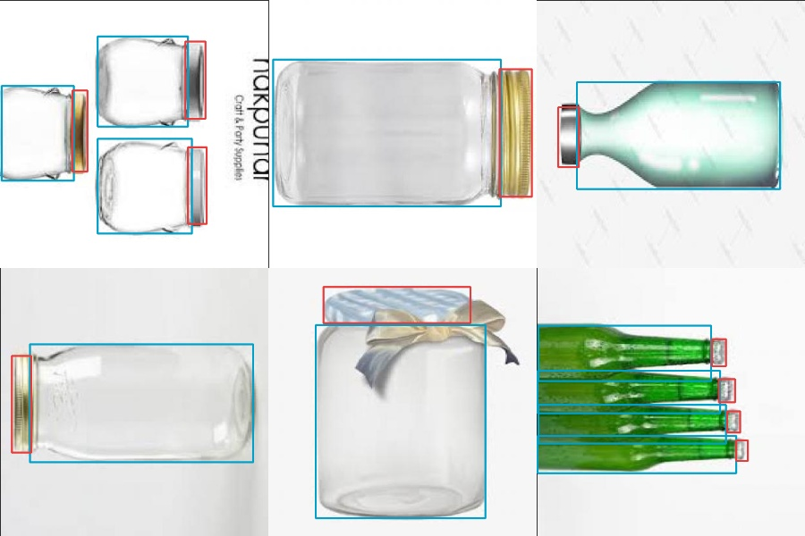

## Limitations of the final model

- Limited recall (about 59%): about half of the objects in crowded scenes are
  not found, which would matter in a real sorting system.
- Weak on small, overlapping and unusually coloured objects.
- Results depend on annotation quality: only a sample of 30 images was visually
  reviewed, and incomplete or inconsistent labels appear as false alarms and
  misses.
-Possible duplicate leakage: the team's wider duplicate search (Assignment 2, Task 1, section 4.4) found 44 of its 307 duplicate groups still crossing the train/validation/test split; about 19 of them were judged real copies of a test image (about 1.2% of the 1,569 test images). The test scores may therefore be slightly optimistic. Duplicates found by neither search can also remain, and duplicates kept inside the same subset can give some sources extra weight.
- One model on one split. Confidence intervals were computed for the mAP
  values (Task 2), not for the counts in this report.
- The figures show 9 selected examples, not a random sample.

## Possible improvements

- **Annotation review:** check crowded and biodegradable images for missing or
  loose boxes and correct genuine errors only (do not remove hard examples).
- **Small and crowded objects:** the stronger recipe (with mosaic) helped
  least for small objects (recall 26% to 30%). Next: tiled (sliced)
  inference, a larger model, or a higher input resolution with a matching
  anchor-free setup; evaluate each on the validation set first.
- **Post-processing:** tune the NMS IoU threshold and the confidence threshold
  for dense scenes, possibly per class.
- **Training:** the training recipe mattered more than training length.
  A short AdamW refinement did not beat the baseline (43.7% vs 44.2%
  validation mAP50-95), while batch 16 with stronger augmentation reached
  51.2%; that run had converged by epoch 50 of 60, so more epochs would not help.
- **Data for cardboard, paper and glass at smaller scale:** these classes are found
  in only 20–38% of medium-size cases; more crowded examples, or copy-paste style augmentation,
  target this directly.
- **Evaluation:** report AP (not only recall) separately for small and crowded
  objects.
